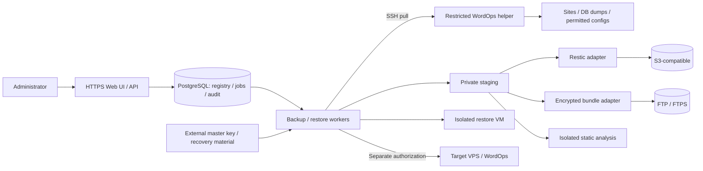
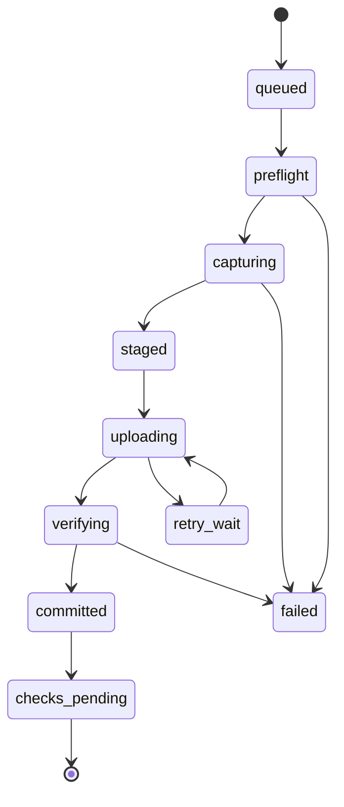
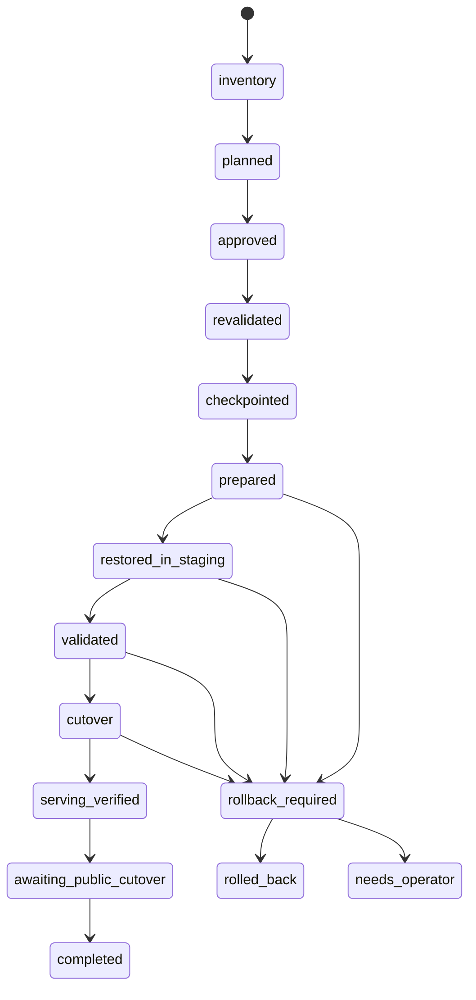

# Architecture proposal

Date: 2026-11-04 · Status: proposed design to validate through spikes.
Normative requirements: [PRD](PRD.md). Component code has not been written yet.

## 1. Deployment

Proposal: a dedicated Linux VPS, Docker Compose, HTTPS reverse proxy, web/API,
durable workers, PostgreSQL and private staging. UI/API must not run long jobs
synchronously. The initial version needs neither Kubernetes nor a mandatory SaaS API.
Ordinary shared hosting without worker/SSH/disk capabilities is unsuitable.

The control host is highly trusted. Compromise of its workers/keys can affect all
accessible sites. Process separation and database encryption reduce individual
leak risks but do not make a compromised worker safe.

## 2. Components and responsibilities

| Component | Responsibility |
|---|---|
| Web/API | Auth/MFA/RBAC, registry, plan preview, confirmations, reports |
| Scheduler | UTC/timezone, catch-up, idempotency, freshness monitoring |
| Job runner | Leases/heartbeats, durable steps, cancellation boundaries, retries |
| SSH transport | Host key pinning, credential delivery, timeouts, output limits |
| WordOps adapter | Inventory, compatibility, create/update metadata, site-scoped planning |
| Backup helper | Permitted site IDs, file reads, DB export, inventory; no PHP as root |
| Restore helper | Separate privileges, single-use plan scope, checkpoints/cutover |
| Storage adapters | Capability test, commit, read/check/delete, recovery catalog |
| Static scanner | Untrusted files/SQL, baseline diff, evidence, limits |
| Restore lab | Separate VM, blocked egress, DB/runtime/smoke tests |
| Key provider | Credential encryption, key IDs, rotation, recovery export |

Proposed stack: Go for API/workers/helpers, PostgreSQL for state, TypeScript web UI.
The language and UI framework will be finalized after G0; they are not user-imposed
constraints. Privileged helpers must be small, with a verifiable protocol; do not
turn them into an arbitrary shell console.

## 3. Data model

| Entity | Important fields |
|---|---|
| Server | id, address, port, host_keys, tags, enrollment, capabilities |
| CredentialRef | type, encrypted_value/ref, scope, expires_at, key_id |
| Inventory | server_id, observed_at, adapter_version, digest, observations, gaps |
| Site | id, server_id, WordOps identity, domain/aliases, root, DB ref, status |
| Storage | id, backend, prefix, credential_ref, capabilities, retention protection |
| BackupPlan | site selection, schedule/timezone, mode, policy_version, limits |
| Job / JobStep | kind, idempotency_key, state, lease, checkpoint, attempt, progress |
| RecoveryPoint | id, site_id, scope, capture interval, engine refs, completeness |
| Verification | point_id, check_kind, scope, time, evidence, result, tool version |
| Finding | site/point, severity, confidence, evidence digests, disposition |
| RestorePlan | point_id, target_id, inventory digest, action graph, hash, expiry |
| Approval | actor, plan_hash, target fingerprint, time, reauthentication |
| AuditEvent | actor, scope, action, object, result, correlation_id, safe metadata |

The registry does not store database passwords, SQL or site contents. Audit holds
references and digests, not dumps. The control database holds a derived catalog;
archived manifests allow it to be rebuilt. Displaying local time does not alter UTC
timestamps.

## 4. Bootstrap and ongoing access

1. The user verifies the host fingerprint through a trusted channel.
2. Read-only inventory uses administrative access, separately from installation.
3. The UI shows an installation plan: helper files, accounts, sudo rules and backup scope.
4. After approval, a pinned helper is installed with checksum/signature verification.
5. Create a persistent backup-access key with a restricted forced-command protocol;
   disable PTY, agent/X11/port forwarding. Plain `rsync` outside the approved protocol
   is forbidden; the helper implements site-scoped transfer or a validated rrsync scheme.
6. Grant sudo only to fixed root-owned helpers, not `bash`, `rsync`, `tar`, `wp` or
   an interpreter accepting arbitrary arguments. The registry allowlist is root-owned.
7. Remove the administrative password from the active session; retaining it requires
   a separate explicit choice. Do not use SSH agent forwarding for persistent access.

A restricted privileged exporter may read files, but site PHP never runs as root.
Dumps use dedicated database privileges, not a PHP import of `wp-config.php`.
Dynamic config logic requires an explicitly configured secret retrieval method;
it cannot safely be guessed through eval.

One system backup user may cover several sites. Its access boundary is the union
of allowlisted sites. Independent customers use separate credentials and storage
scopes; the first release does not promise SaaS tenant isolation.

## 5. Capture and recovery-point publication

`committed` means storage is complete, not malware-free or restore-tested.
Findings/checks update separate records. Problematic backups are retained with
appropriate labels; job “success” must not hide degraded capture consistency.

Capture uses a free-space preflight and a lock. Online mode records the files/database
interval and checks conflicting changes. Strict/quiesced profiles pre-transfer the
main files, stop all known writers, then perform final sync and a transactional dump.
All writer states are retained for cleanup. Worker loss requires a bounded lease
and a managed watchdog; creating `.maintenance` alone provides no such guarantee.
Strict mode is not enabled when the freeze is unconfirmed.

A logical database dump is not a copy of `/var/lib/mysql`. Client/server versions
are recorded. Triggers, routines, events and views are inventoried, and their
inclusion/exclusion is explicit. Definers and event execution are not automatically
carried into production. Nontransactional tables and DDL need a separate strategy,
not a silent fallback.

Transfers must not follow arbitrary symlinks outside the allowlist. The archive
preserves permitted links as metadata, but target restoration validates allowed
paths separately. Reject devices, sockets, setuid/setgid executables, and treating
archived UIDs as instructions to create system users.

## 6. Storage adapters

### S3 / Restic

Proposal: a separate repository per site or limited trust group, Restic encryption,
a stable path layout and a manifest inside each snapshot. Repository separation
limits leak scope and simplifies retention but reduces cross-site deduplication.
Restic reads data from external control-plane staging; S3 credentials never reach
production. Recovery-point identity is independent of the mutable domain string.

After the engine confirms a snapshot, the catalog records a commit. If a crash
occurs between these steps, reconciliation finds the snapshot by operation ID and
finishes registration without repeating capture. Prune is serialized with repository
operations. Full reads and structural checks have independent results.

### FTP / FTPS

Proposed fallback: full independent `tar.zst` bundles encrypted with standard age,
split into parts for resumable transfer. The manifest records sizes, order and
digests, and is itself signed with the control-plane key and encrypted. Resuming
means transferring an already formed dataset; a new dump is not appended to old parts.

Upload unique objects first, then the manifest, then a commit marker. A reader trusts
a point only after signature verification, decryption and verification of all required
objects. Neither FTP mtime nor marker presence replaces readback. Full FTP readback
is mandatory before confirming integrity; structural status is shown separately.
The signature proves manifest origin, not the absence of source compromise.

Do not implement cryptographic primitives. Container format, signature library and
versioning require a separate spike specification. The first stable release must
not depend on an experimental bundle parser.

### Immutable copy

An additional independent copy with retention protection is P1. Separately test
Restic lock/index/prune with Object Lock, S3 versioning, recovery of old object
versions and protection against delete markers. Enabling S3 Versioning alone is
not sufficient protection against an administrator with permanent-delete rights.

## 7. Restore orchestration

For create, checkpointed records the original target inventory and the site's
absence; for replace, it requires an actual verified safety copy. Inventory,
approval and revalidation failures stop before changes; checkpoint failure cancels
replacement. Lease loss after any mutation triggers reconciliation, not blind retry.

The action graph includes preconditions/postconditions, idempotency and compensation
for every step. Package installation is not atomic. On a clean VPS, failure may
require manual cleanup/reprovisioning; show this before approval. Never automatically
migrate the stack on an occupied VPS.

Restoration consists of safe extraction, a new least-privilege database, adapting
database credentials/URLs, configs and smoke tests. SQL is untrusted data: do not
import it as database root with FILE/SUPER or permission to create other databases.
Executable triggers/events and server commands require restrictions and separate review.

Integration tests verify WordOps metadata/vhost/docroot/database cutover. If an adapter
cannot support a safe staging layout, block that restore mode; ordinary rsync cannot
justify a zero-downtime promise. Replacement keeps writes frozen until final validation.
Once writes resume, restoring an old checkpoint is a new potentially destructive action.

DNS is unchanged. HTTPS previews use correct Host/SNI; test integrations are disabled
at network and application levels. The UI separately reports `serving_verified`,
`awaiting_public_cutover` and `completed`.

## 8. Checks and trusted baselines

Static scans run in a sandbox with read-only input, resource limits and controlled
network requests to trusted checksum sources. A custom-code baseline has a release
ID, digest and explicit approval. Automatically accepting all changes after every
backup is not an allowed policy.

Database analysis does not start restored WordPress. SQL is handled by a safe,
restricted parser or imported into a disposable database without global privileges.
Dynamic restore tests run in a separate VM, especially for suspicious copies.
A Docker container with host mounts and privileges does not provide this isolation.

## 9. Recovery kit and control-plane recovery

The kit includes a versioned configuration export, catalog hints, repository
locations, format/engine versions, wrapped encryption keys and offline CLI recovery
instructions. SSH/root credentials may only be exported separately and explicitly;
they are not required to recover data. Never place a plaintext master key beside
ciphertext.

On the new control plane, decrypt/import, connect storage, verify manifests, rebuild
the catalog and check access. Disable all schedules/restore approvals. Even if the
kit is outdated, newer points remain discoverable from storage when keys are available.

## 10. Architecture checks before implementation selection

- Measure staging disk usage, dump size, CPU, S3 requests/egress and RTO.
- Check actual WordOps CLI behavior and version differences; do not rely on old docs.
- Test restarts at every state-machine boundary, host-key rotation and revocation.
- Verify that the backup key cannot invoke restore, arbitrary `wp` or a shell.
- Recover without the source, old control plane, GitHub or original plugin downloads.
- Validate FTP format, readback, damaged parts and absence of false commits.
