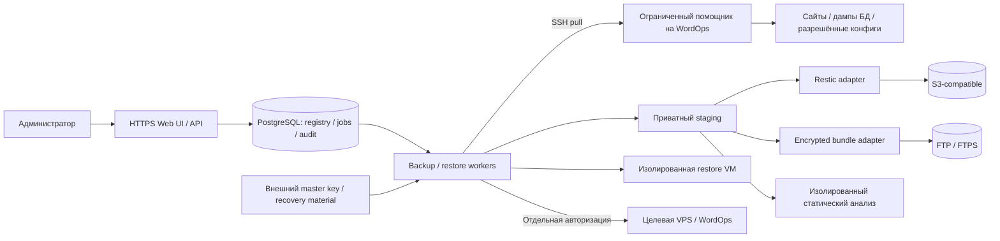
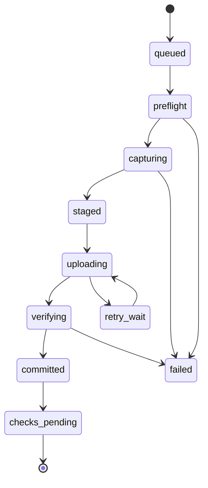
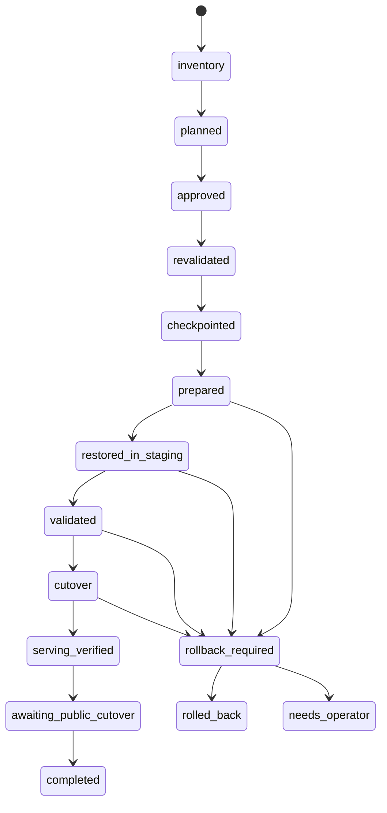

# Архитектурное предложение

Дата: 2026-11-04 · Статус: проектное решение для проверки spikes.
Нормативные требования: [PRD](PRD.md). Код компонентов ещё не написан.

## 1. Развёртывание

Предложение: отдельная Linux VPS, Docker Compose, HTTPS reverse proxy, web/API,
durable workers, PostgreSQL и приватный staging. UI/API не запускают длительные
задания синхронно. Первый вариант без Kubernetes и без обязательного SaaS API.
Обычный shared hosting без worker/SSH/disk capabilities не подходит.

Control host — высокодоверенный узел. Компрометация его workers/ключей может
затронуть все доступные сайты. Разделение процессов и шифрование БД уменьшают
риски отдельных утечек, но не делают скомпрометированный worker безопасным.

## 2. Компоненты и ответственность

| Компонент | Ответственность |
|---|---|
| Web/API | Auth/MFA/RBAC, registry, plan preview, confirmations, reports |
| Scheduler | UTC/timezone, catch-up, idempotency, freshness monitoring |
| Job runner | Leases/heartbeats, durable steps, cancellation boundaries, retries |
| SSH transport | Host key pinning, credential delivery, timeouts, output limits |
| WordOps adapter | Inventory, compatibility, create/update metadata, site-scoped planning |
| Backup helper | Разрешённые site IDs, чтение файлов, DB export, inventory; без root PHP |
| Restore helper | Отдельные полномочия, одноразовый plan scope, checkpoints/cutover |
| Storage adapters | Capability test, commit, read/check/delete, recovery catalog |
| Static scanner | Недоверенные файлы/SQL, baseline diff, evidence, limits |
| Restore lab | Отдельная VM, запрещённый egress, DB/runtime/smoke tests |
| Key provider | Шифрование credentials, key IDs, rotation, recovery export |

Предложенный стек: Go для API/workers/helpers, PostgreSQL для состояния,
TypeScript web UI. Язык и UI framework окончательно выбираются после G0;
они не являются пользовательским ограничением. Привилегированные helpers должны
быть малы, с проверяемым протоколом; не переносить в них произвольную shell-консоль.

## 3. Модель данных

| Сущность | Важные поля |
|---|---|
| Server | id, address, port, host_keys, tags, enrollment, capabilities |
| CredentialRef | type, encrypted_value/ref, scope, expires_at, key_id |
| Inventory | server_id, observed_at, adapter_version, digest, observations, gaps |
| Site | id, server_id, WordOps identity, domain/aliases, root, DB ref, status |
| Storage | id, backend, prefix, credential_ref, capabilities, retention protection |
| BackupPlan | site selection, schedule/timezone, mode, policy_version, limits |
| Job / JobStep | kind, idempotency_key, state, lease, checkpoint, attempt, progress |
| RecoveryPoint | id, site_id, scope, capture interval, engine refs, completeness |
| Verification | point_id, check_kind, scope, time, evidence, result, tool version |
| Finding | site/point, severity, confidence, evidence digests, disposition |
| RestorePlan | point_id, target_id, inventory digest, action graph, hash, expiry |
| Approval | actor, plan_hash, target fingerprint, time, reauthentication |
| AuditEvent | actor, scope, action, object, result, correlation_id, safe metadata |

Пароли БД, SQL и содержимое сайтов в registry не хранятся. В audit — ссылки и
digests, а не дампы. Control DB хранит производный каталог; архивные manifest
позволяют восстановить его заново. Локальное время отображения не меняет UTC timestamps.

## 4. Bootstrap и постоянный доступ

1. Пользователь подтверждает host fingerprint по доверенному каналу.
2. Read-only inventory собирается административным доступом, отдельно от install.
3. UI показывает план установки: файлы helper, accounts, sudo rules, backup scope.
4. После approval устанавливается закреплённый helper с checksum/signature.
5. Создаётся ключ постоянного backup-доступа с ограниченным forced-command protocol;
   отключены PTY, agent/X11/port forwarding. Plain `rsync` вне разрешённого протокола
   не допускается; helper реализует site-scoped transfer либо проверенную rrsync-схему.
6. Sudo выдаётся только фиксированным root-owned helper, не `bash`, `rsync`, `tar`,
   `wp` или интерпретатору с произвольными аргументами. Registry allowlist root-owned.
7. Административный пароль удаляется из оперативного сеанса; сохранение только
   по отдельному выбору. Не сохранять SSH agent forwarding как механизм доступа.

Файлы могут читаться через ограниченный privileged exporter, но PHP сайта никогда
не выполняется с root. Дамп выполняется с выделенными DB privileges, а не импортом
`wp-config.php` как PHP. Конфиг с динамической логикой требует явно настроенного
способа получения секрета; нельзя безопасно «догадаться» через eval.

Для нескольких сайтов один системный backup-пользователь допустим. Граница его
доступа — совокупность allowlisted сайтов. Для независимых клиентов используются
разные credentials и области хранения; первый выпуск не обещает SaaS tenant isolation.

## 5. Capture и публикация точки

`committed` означает завершённое хранение, не malware-free и не restore-tested.
Findings/проверки обновляют отдельные записи. Копии с проблемами сохраняются с
соответствующей меткой; «успех» задания не скрывает degraded capture consistency.

Capture использует preflight свободного места и lock. Для online режима сохраняется
интервал files/DB и проверяются конфликты изменений. Для strict/quiesced профиля
сначала передаются основные файлы, затем останавливаются все известные writers,
выполняются final sync и transaction dump. Все writer states сохраняются для cleanup.
Потеря worker должна иметь ограниченную lease и управляемый watchdog; только создание
`.maintenance` такой гарантии не даёт. При неподтверждённом freeze strict не включается.

Logical DB dump — не копирование `/var/lib/mysql`. Версии client/server фиксируются.
Triggers, routines, events и views инвентаризируются; их включение/исключение явно
записывается. Дефайнеры и event execution не переносятся автоматически в production.
Нетранзакционные таблицы и DDL требуют отдельной стратегии, а не тихого fallback.

При передаче не следовать произвольным symlink за пределы allowlist. Archive
сохраняет допустимые ссылки как метаданные, но target restore валидирует разрешённые
пути отдельно. Не допускать устройств, sockets, setuid/setgid исполняемых файлов и
архивных UID как инструкций для создания системных пользователей.

## 6. Storage adapters

### S3 / Restic

Предложение — отдельный repository на site или ограниченную группу доверия,
шифрование Restic, stable path layout и manifest внутри snapshot. Разделение repo
снижает масштаб утечки и упрощает retention, но уменьшает cross-site dedup.
Данные поступают в Restic из staging внешнего центра; credentials S3 на production
не передаются. Идентификатор точки не совпадает с изменяемой строкой домена.

После подтверждения engine snapshot каталог фиксирует commit record. При падении
между этими шагами reconciliation находит snapshot по operation ID и завершает
регистрацию без повторного capture. Prune сериализуется с repository operations.
Полное чтение и структурные checks имеют независимые результаты.

### FTP / FTPS

Предлагаемый fallback: полные независимые `tar.zst` bundles, шифруемые стандартным
age, разбитые на части для возобновления transfer. Manifest содержит их размеры,
порядок и digest, а сам подписан ключом центра и зашифрован. Возобновление касается
передачи уже сформированного набора; новый dump не приклеивается к старым частям.

Сначала отправляются unique objects, затем manifest, последним commit marker.
Reader доверяет точке только после проверки signature, decrypt и всех необходимых
объектов. Ни FTP mtime, ни наличие marker не заменяют readback. Для FTP full readback
перед подтверждением integrity обязателен; structural status отображается отдельно.
Подпись не доказывает отсутствие взлома источника — только происхождение manifest.

Никакой собственной реализации криптографических примитивов. Формат container,
signature library и versioning подлежат отдельной спецификации в spike. Первая
стабильная версия не должна зависеть от экспериментального bundle parser.

### Неизменяемая копия

Дополнительная независимая копия с retention protection — P1. Нужно отдельно
испытать Restic lock/index/prune и Object Lock, версионность S3, восстановление
старых object versions и защиту от delete markers. Нельзя считать включённую
галочку S3 Versioning достаточной защитой от администратора с правом permanent delete.

## 7. Restore orchestration

Для create шаг checkpointed фиксирует исходный target inventory и факт отсутствия
сайта; для replace он требует реальную проверенную safety copy. Ошибки inventory,
approval и revalidation завершаются до изменений; ошибки checkpoint отменяют замену.
Потеря lease после любой мутации переводит job в reconciliation, а не слепой retry.

Action graph содержит preconditions/postconditions, idempotency и compensation для
каждого шага. Установка пакетов не является атомарной транзакцией. На чистой VPS её
неуспех может потребовать ручной cleanup/reprovision; это показывается до approval.
На занятой VPS stack migration автоматически не выполняется.

Restore stage состоит из безопасной распаковки, новой БД с минимальными правами,
адаптации DB credentials/URLs, конфигов и smoke tests. SQL — недоверенные данные:
не импортировать его DB-root с правами FILE/SUPER/создания чужих БД. Исполняемые
triggers/events и серверные команды требуют ограничений и отдельного review.

WordOps metadata/vhost/docroot/DB cutover проверяются интеграционными тестами.
Если безопасный staging layout не поддерживается конкретным адаптером, restore
mode для него блокируется; нельзя обещать нулевой downtime через обычный rsync.
Replace выполняется в write freeze до финальной проверки. После возобновления
записей откат к старому checkpoint — новое потенциально разрушительное действие.

DNS не меняется. HTTPS preview выполняется с корректными Host/SNI; тестовые
интеграции отключены на уровне сети и приложения. В UI отдельно отражаются
`serving_verified`, `awaiting_public_cutover`, `completed`.

## 8. Проверки и доверенные эталоны

Static scan выполняется в sandbox с read-only input, ресурсными лимитами и
контролируемыми сетевыми запросами к доверенным checksum sources. Baseline собственного
кода имеет release ID, digest и явное approval. «Принять все изменения» после каждой
копии не допускается как автоматическая политика.

DB analysis не запускает восстановленный WordPress. SQL разбирается безопасным
ограниченным parser или импортируется в одноразовую БД без глобальных привилегий.
Dynamic restore test выполняется в отдельной VM, особенно для suspicious copies.
Docker-контейнер с host mounts и привилегиями не считается такой изоляцией.

## 9. Recovery kit и восстановление центра

Kit включает versioned configuration export, catalog hints, repository locations,
format/engine versions, wrapped encryption keys и инструкции offline CLI recovery.
SSH/root credentials можно экспортировать только отдельно и явно; для восстановления
данных они не обязательны. Мастер-ключ не включается открыто рядом с ciphertext.

На новом центре выполняются decrypt/import, подключение storage, верификация manifest,
rebuild каталога и проверка доступа. Все schedules/restore approvals отключены.
Если kit устарел, новые точки всё равно обнаруживаются из storage при наличии ключей.

## 10. Проверки архитектуры до выбора реализации

- Измерить staging disk usage, dump size, CPU, S3 requests/egress и RTO.
- Проверить фактический CLI WordOps и различия версий, не полагаться на старые docs.
- Испытать restart в каждой границе state machine, host key rotation и revoke.
- Проверить, что ключ backup не может вызвать restore, произвольный `wp` или shell.
- Сделать recovery без источника, старого центра, GitHub и исходных plugin downloads.
- Подтвердить FTP формат, readback, повреждения частей и отсутствие ложного commit.
